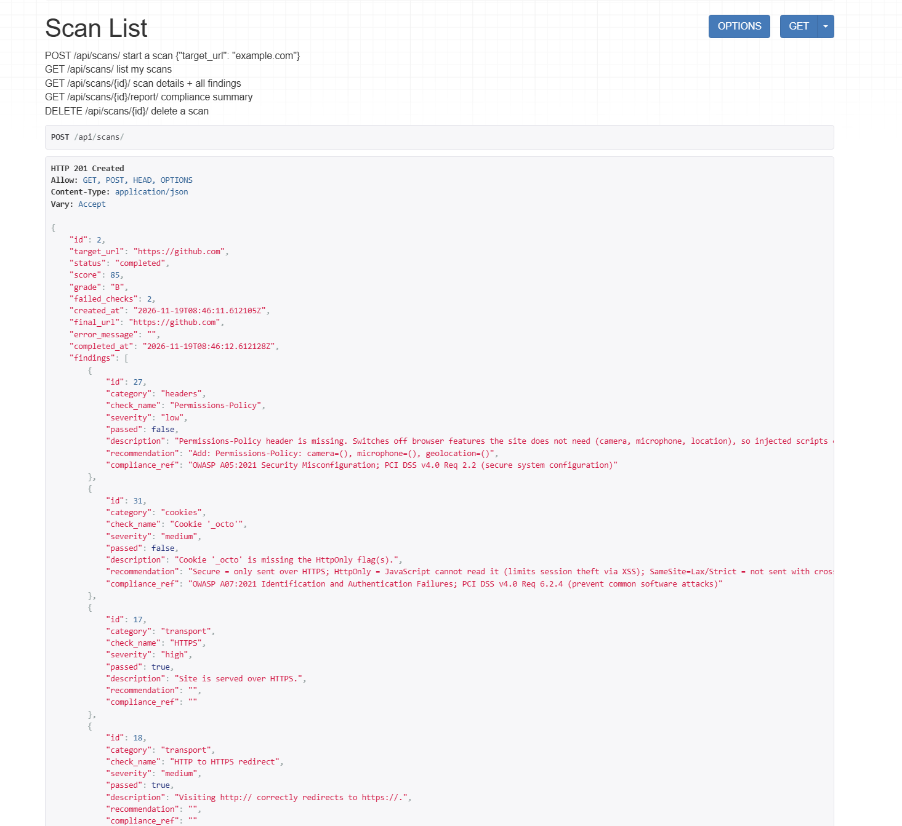
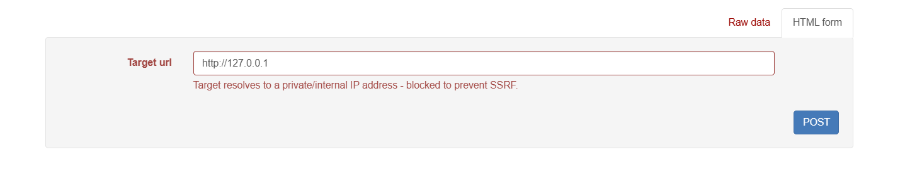
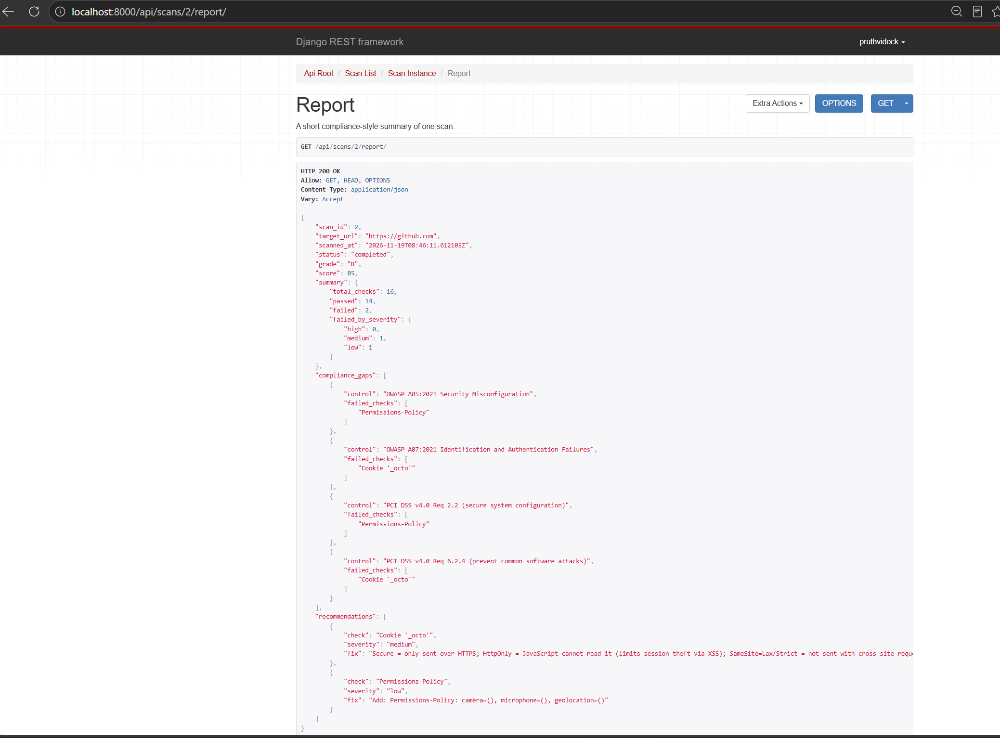
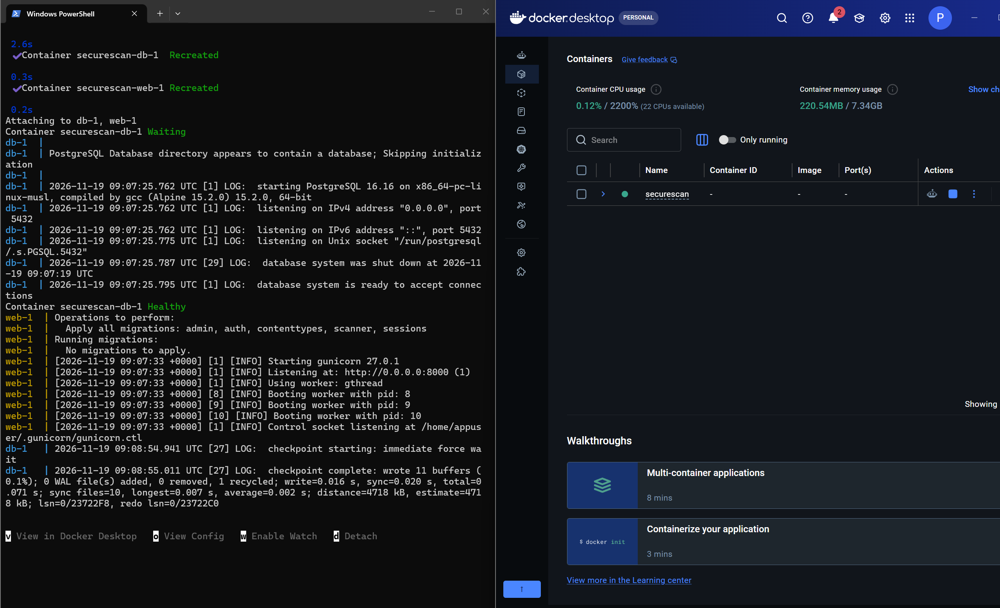
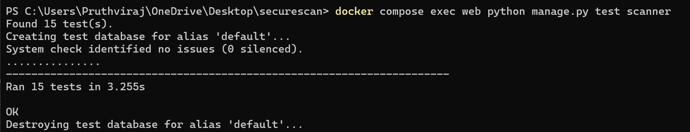

# SecureScan – Web Security Posture Scanner

A REST API that audits a website's security configuration. You give it a URL and it checks HTTPS, the SSL/TLS certificate, security headers, cookie flags and information leakage. It then grades the site from A to F and maps every failed check to **OWASP Top 10 (2021)** and **PCI DSS v4.0** controls.

**Tech stack:** Python · Django · Django REST Framework · JWT · PostgreSQL · Docker Compose

---

## Features

| Check | What it looks for |
|---|---|
| **HTTPS** | Is the site served over HTTPS? Does `http://` redirect to `https://`? |
| **SSL/TLS certificate** | Trusted chain and hostname, days until expiry, TLS version (1.2/1.3 only) |
| **Security headers** | `Strict-Transport-Security`, `Content-Security-Policy`, `X-Frame-Options`, `X-Content-Type-Options`, `Referrer-Policy`, `Permissions-Policy` |
| **Information disclosure** | `Server` header showing a version, `X-Powered-By`, `X-AspNet-Version` |
| **Cookie security** | `Secure`, `HttpOnly` and `SameSite` flags on every cookie |

**Scoring:** start at 100, subtract 20 / 10 / 5 per failed High / Medium / Low check.
Grades: A ≥ 90, B ≥ 80, C ≥ 70, D ≥ 60, F < 60.

---


## Demo

**Scan result** – github.com graded B with findings mapped to OWASP / PCI DSS


**SSRF protection** – internal addresses are blocked before any request is made


**Compliance report**


**Running with Docker Compose (Django + PostgreSQL)** and **15 passing tests**




---

### The scanner is itself built securely

- **SSRF protection.** Before every request, *including every redirect hop*, the hostname is resolved and private, loopback, link-local and cloud-metadata IPs are refused (`127.0.0.1`, `10.x`, `192.168.x`, `169.254.169.254`, `::1` …). Only `http`/`https` on ports 80/443 are allowed, and credentials in URLs are rejected.
- **JWT authentication.** Short-lived access tokens (30 min) plus refresh tokens.
- **IDOR prevention.** Every query is filtered by the logged-in user, so another user's scan ID returns `404`.
- **Rate limiting.** Each user can start 10 scans per hour (configurable). Anonymous endpoints like login are throttled to slow down brute-force attempts.
- **Strong passwords.** Django's password validators run on registration, and passwords are stored as PBKDF2 hashes.
- **Secrets in `.env`**, never in code. The app runs as a **non-root user** in Docker, and **PostgreSQL is not exposed** to the host.
- **The app sets its own security headers** (`nosniff`, `X-Frame-Options: DENY`, `Referrer-Policy`, and HSTS/secure cookies when `DJANGO_HTTPS=True`).
- Internal errors are logged but never shown to API users.

---

## Architecture

```
Client (curl / Postman / browser)
        │  JWT
        ▼
┌──────────────────────── web container ────────────────────────┐
│ Django REST Framework                                         │
│  views.py ──► serializers.py (input validation + SSRF check)  │
│      │                                                        │
│      └──► services/engine.py ──► services/ssrf.py             │
│              │  safe_fetch() → target website (headers only)  │
│              │  check_certificate() → TLS socket on :443      │
│              ▼                                                │
│          findings + score + grade                             │
└──────────────┬────────────────────────────────────────────────┘
               │ Django ORM
               ▼
        db container (PostgreSQL 16) – Scan, Finding tables
```

## Project structure

```
securescan/
├── config/                 # Django project: settings, urls, wsgi
├── scanner/
│   ├── models.py           # Scan and Finding tables
│   ├── serializers.py      # input validation, JSON output
│   ├── views.py            # API endpoints, report, rate limiting
│   ├── services/
│   │   ├── engine.py       # all security checks + scoring
│   │   └── ssrf.py         # SSRF protection
│   └── tests.py            # 15 unit + API tests
├── Dockerfile
├── docker-compose.yml
├── entrypoint.sh
└── .env.example
```

---

## Quick start on Windows (PowerShell)

You need Docker Desktop installed and running (it uses WSL 2).

```powershell
cd securescan
Copy-Item .env.example .env
notepad .env                     # change DJANGO_SECRET_KEY and POSTGRES_PASSWORD, then save
docker compose up --build
```

Leave that window running. Open a **second** PowerShell window to call the API:

```powershell
# 1. Register and log in
$body = @{ username = "pruthvi"; password = "Str0ng-Pass-2026" } | ConvertTo-Json
Invoke-RestMethod -Method Post -Uri http://localhost:8000/api/auth/register/ -ContentType "application/json" -Body $body
$token = (Invoke-RestMethod -Method Post -Uri http://localhost:8000/api/auth/token/ -ContentType "application/json" -Body $body).access
$headers = @{ Authorization = "Bearer $token" }

# 2. Scan a website
$scan = Invoke-RestMethod -Method Post -Uri http://localhost:8000/api/scans/ -Headers $headers `
        -ContentType "application/json" -Body (@{ target_url = "github.com" } | ConvertTo-Json)
"Grade: $($scan.grade)  Score: $($scan.score)"
$scan.findings | Format-Table check_name, severity, passed -AutoSize

# 3. Compliance report
Invoke-RestMethod -Uri "http://localhost:8000/api/scans/$($scan.id)/report/" -Headers $headers | ConvertTo-Json -Depth 5

# 4. SSRF protection demo (should return 400 Bad Request)
Invoke-RestMethod -Method Post -Uri http://localhost:8000/api/scans/ -Headers $headers `
        -ContentType "application/json" -Body (@{ target_url = "http://169.254.169.254/" } | ConvertTo-Json)
```

> In Windows PowerShell, `curl` is an alias for `Invoke-WebRequest`, so the bash `curl` examples below won't work as written. Use the commands above, Postman, or `curl.exe`.

**No-command-line option:** open http://localhost:8000/api/auth/register/ in your browser and register with the form. Log in at http://localhost:8000/api-auth/login/, then go to http://localhost:8000/api/scans/ and use the form at the bottom to start a scan.

## Quick start (macOS / Linux)

You need Docker Desktop running.

```bash
cp .env.example .env              # then edit the secret key and DB password
docker compose up --build
```

The API is now at **http://localhost:8000/api/**.

Optional, for the admin panel at http://localhost:8000/admin/:

```bash
docker compose exec web python manage.py createsuperuser
```

Run the tests inside the container:

```bash
docker compose exec web python manage.py test scanner
```

---

## API usage

### 1. Register and get a token

```bash
curl -X POST http://localhost:8000/api/auth/register/ \
  -H "Content-Type: application/json" \
  -d '{"username": "pruthvi", "password": "Str0ng-Pass-2026"}'

curl -X POST http://localhost:8000/api/auth/token/ \
  -H "Content-Type: application/json" \
  -d '{"username": "pruthvi", "password": "Str0ng-Pass-2026"}'
# → {"refresh": "...", "access": "eyJhbGciOi..."}
```

```bash
TOKEN=eyJhbGciOi...   # paste the access token
```

### 2. Start a scan

```bash
curl -X POST http://localhost:8000/api/scans/ \
  -H "Authorization: Bearer $TOKEN" \
  -H "Content-Type: application/json" \
  -d '{"target_url": "github.com"}'
```

Example response (shortened):

```json
{
  "id": 1,
  "target_url": "https://github.com",
  "status": "completed",
  "score": 90,
  "grade": "A",
  "failed_checks": 1,
  "findings": [
    {
      "check_name": "Permissions-Policy",
      "severity": "low",
      "passed": false,
      "description": "Permissions-Policy header is missing. ...",
      "recommendation": "Add: Permissions-Policy: camera=(), microphone=(), geolocation=()",
      "compliance_ref": "OWASP A05:2021 Security Misconfiguration; PCI DSS v4.0 Req 2.2 (secure system configuration)"
    }
  ]
}
```

### 3. Other endpoints

| Method | Endpoint | Description |
|---|---|---|
| `POST` | `/api/auth/register/` | Create an account |
| `POST` | `/api/auth/token/` | Log in, get JWT access + refresh tokens |
| `POST` | `/api/auth/token/refresh/` | Get a new access token |
| `POST` | `/api/scans/` | Start a scan |
| `GET` | `/api/scans/` | List my scans (paginated) |
| `GET` | `/api/scans/{id}/` | Scan details with all findings |
| `GET` | `/api/scans/{id}/report/` | Compliance summary: counts by severity, OWASP/PCI gaps, prioritised fixes |
| `DELETE` | `/api/scans/{id}/` | Delete a scan |
| `GET` | `/api/health/` | Health check |

Try the SSRF protection:

```bash
curl -X POST http://localhost:8000/api/scans/ -H "Authorization: Bearer $TOKEN" \
  -H "Content-Type: application/json" -d '{"target_url": "http://169.254.169.254/"}'
# → 400 {"target_url": ["Target resolves to a private/internal IP address - blocked to prevent SSRF."]}
```

---

## What each security header protects against

| Header | Attack it prevents |
|---|---|
| `Strict-Transport-Security` | SSL stripping: an attacker on public Wi-Fi downgrading the user to HTTP |
| `Content-Security-Policy` | Cross-Site Scripting (XSS): injected scripts can't load or run |
| `X-Frame-Options` | Clickjacking: the page loaded in an invisible iframe to trick clicks |
| `X-Content-Type-Options: nosniff` | MIME sniffing: a browser running an uploaded text file as JavaScript |
| `Referrer-Policy` | Leaking URLs (with tokens or IDs) to other sites |
| `Permissions-Policy` | Injected scripts abusing the camera, microphone or location |
| Cookie `Secure` / `HttpOnly` / `SameSite` | Cookie theft over HTTP / via XSS / CSRF |

---

## Known limitations and future work

- **DNS rebinding.** The hostname is resolved once for validation and again by `requests`. A fix is to connect to the already-validated IP address directly.
- Scans run synchronously. **Celery + Redis** would allow background scans and scheduled re-scans.
- Some cookies (like CSRF tokens) legitimately skip `HttpOnly`, so cookie findings need human review.


> Only scan websites you own or have permission to test. SecureScan sends normal `GET` requests and reads response headers, the same as a browser.
